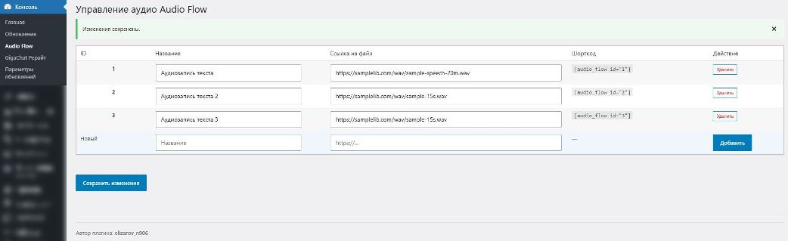

# Audio Flow

  

## Продвинутый аудио-плеер с удобным управлением и шорткодами

**Audio Flow** — легкий и мощный плагин для встраивания стильных аудио-плееров на сайт. Позволяет управлять библиотекой треков прямо из админки и выводить их в любом месте сайта с помощью простых шорткодов.

[Описание](#о-плагине) · [Возможности](#возможности) · [Установка](#установка) · [Использование](#использование) · [Лицензия](#лицензия)

---

## О плагине

Audio Flow решает проблему стандартных аудио-плееров WordPress, предлагая современный дизайн, гибкое управление и стабильную работу. 

Главное удобство плагина заключается в том, что **меню настроек расположено прямо в разделе "Консоль"** (самый первый пункт админ-панели), что обеспечивает мгновенный доступ к управлению медиа без лишних кликов по глубоким меню.

---

## Возможности

*   **Удобное расположение:** Пункт меню "Audio Flow" находится в разделе "Консоль" для быстрого доступа.
*   **Стабильные ID:** У каждого трека уникальный, неизменяемый ID. Вы можете удалять или менять порядок треков в админке — шорткоды `[audio_flow id="X"]` в ваших статьях **никогда не сломаются**.
*   **Оптимизация:** CSS-стили и JavaScript загружаются на странице строго один раз, независимо от количества плееров, что не замедляет сайт.
*   **Современный UI:** Адаптивный дизайн, кастомный ползунок громкости, прогресс-бар с предпросмотром времени при наведении и плавные анимации.
*   **Безопасность:** Полная санитизация данных и защита форм через WordPress Nonce.

---

## Установка

1. Скачайте ZIP-архив из раздела **Releases**.
2. Перейдите в админке WordPress: **Плагины → Добавить новый → Загрузить плагин**.
3. Выберите файл `audio-flow.zip` и нажмите **Установить**.
4. Активируйте плагин.
5. Перейдите в раздел **Консоль → Audio Flow** для управления треками.

---

## Использование

1. Откройте **Консоль → Audio Flow**.
2. Добавьте новый трек, указав его название и прямую ссылку на аудиофайл (например, `.mp3`). Нажмите "Добавить", а затем "Сохранить изменения".
3. Обратите внимание на колонку **Шорткод**. Скопируйте его (например, `[audio_flow id="1"]`).
4. Вставьте этот шорткод в любую запись, страницу или виджет WordPress, где должен появиться плеер.

---

## Скриншоты

  
   <em>Удобное управление библиотекой треков прямо в разделе "Консоль"</em>

 

  
   <em>Стильный и адаптивный внешний вид плеера на фронтенде сайта</em>

---

## Лицензия

Copyright © 2024 Elizarov_n906

Этот плагин распространяется под лицензией **GNU General Public License v2 (GPLv2)**.  
Это означает, что вы можете свободно использовать, изменять и распространять плагин при условии сохранения открытости исходного кода.

   
  Разработано — <a href="https://github.com/elizarov-n906">Elizarov_n906</a>

